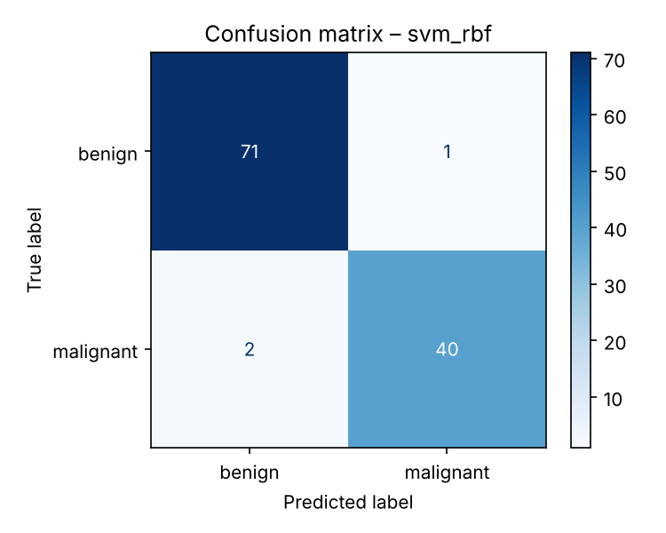
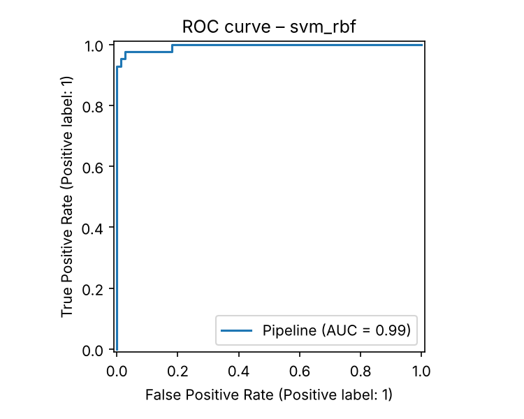
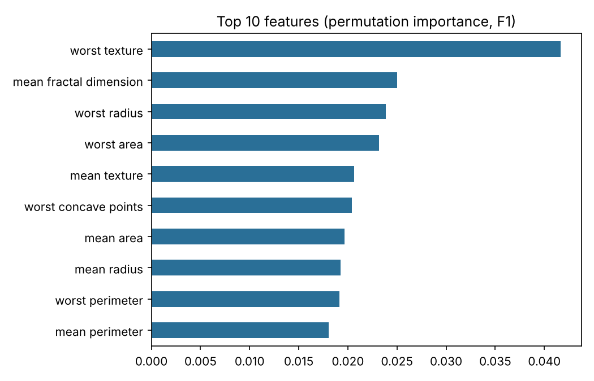

# Breast Cancer Diagnosis – End-to-End ML Pipeline


A reproducible machine-learning project that classifies breast tumours as **benign** or **malignant** from cell-nucleus measurements (Wisconsin Diagnostic Breast Cancer dataset, 569 samples, 30 features).

It covers the full workflow: data loading, leak-free preprocessing, model comparison with cross-validation, held-out evaluation, interpretability, model persistence, a CLI for inference, unit tests and CI.

## Results (held-out test set, 20% stratified split)

| Metric | Score |
|---|---|
| Accuracy | 0.974 |
| Precision | 0.976 |
| Recall (malignant) | 0.952 |
| F1 | 0.964 |
| ROC-AUC | 0.995 |

Best model (selected by 5-fold CV F1): **SVM (RBF) with probability calibration**. Full CV comparison of four models is in [`reports/cv_results.csv`](reports/cv_results.csv).

| Confusion matrix | ROC curve |
|---|---|
|  |  |



## Design decisions

- **Pipelines, not manual scaling**: `StandardScaler` lives inside each `Pipeline`, so cross-validation never leaks statistics from validation folds.
- **Model selection on CV only**: the test set is touched exactly once, for the final report.
- **Recall matters**: in a screening context a missed malignancy is costlier than a false alarm, so recall is reported alongside precision and F1.
- **Permutation importance** on the test set for model-agnostic interpretability.

## Quick start

```bash
git clone https://github.com/YOUR_USERNAME/cancer-diagnosis-ml.git
cd cancer-diagnosis-ml
python -m venv .venv && source .venv/bin/activate
pip install -e ".[dev]"

python -m cancer_ml.train          # trains, evaluates, writes reports/ and models/
pytest                             # runs tests
python -m cancer_ml.predict samples.csv   # predict from a CSV with the 30 feature columns
```

## Project structure

```
src/cancer_ml/
  data.py      # loading + stratified split
  models.py    # candidate pipelines
  train.py     # CV comparison, evaluation, plots, model saving
  predict.py   # CLI inference
tests/         # pytest suite
reports/       # metrics, CV table, figures
models/        # saved model (joblib)
```

## Tech stack

Python · scikit-learn · pandas · matplotlib · joblib · pytest · GitHub Actions

## Disclaimer

Educational project only. Not a medical device and not for clinical use.
